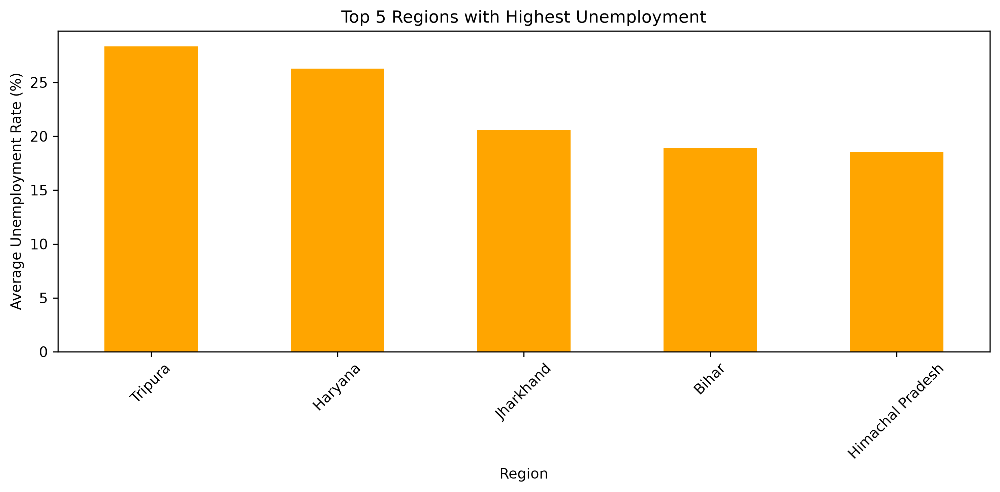
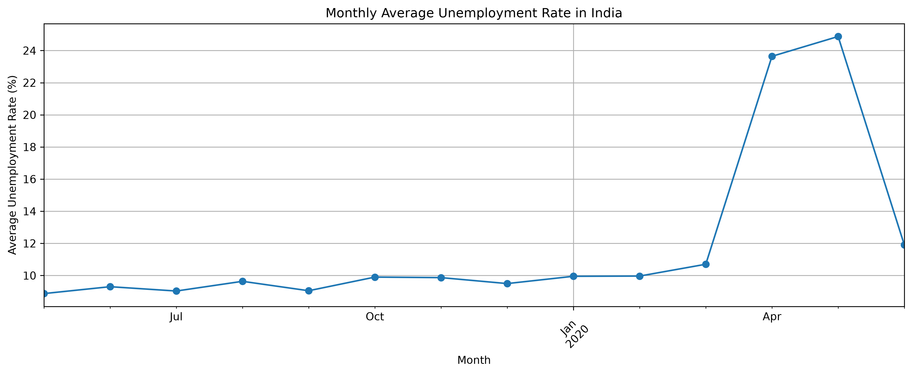
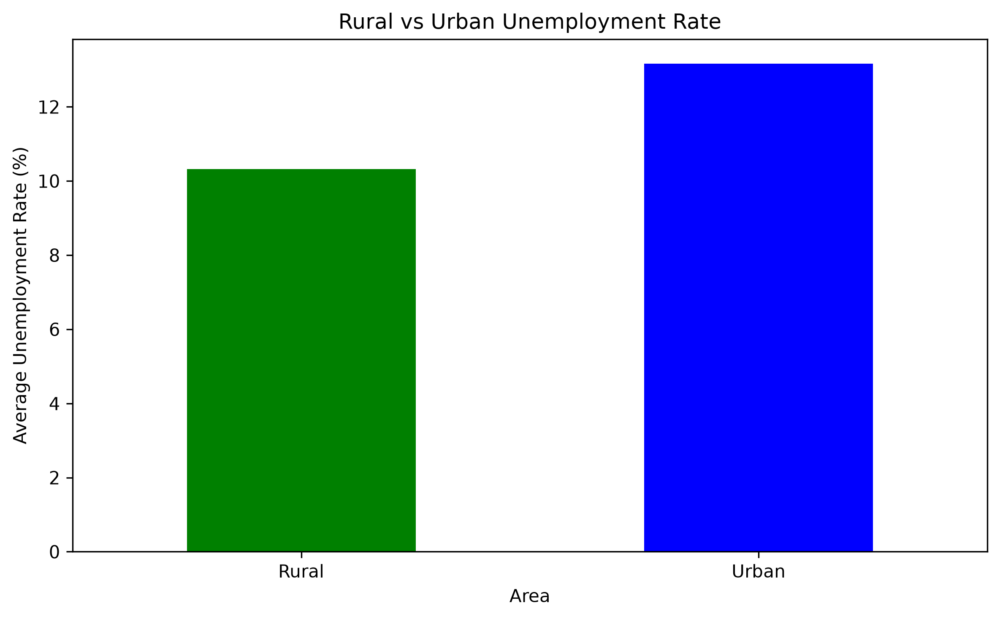

# Unemployment Analysis with Python

## Project Overview
This project focuses on analyzing unemployment trends in India using Python. It explores unemployment rates across different regions, compares rural and urban unemployment, and investigates changes during the COVID-19 period.

## Objectives
- Analyze unemployment rates across Indian regions.
- Identify key unemployment patterns and trends.
- Study the impact of the COVID-19 period on unemployment rates.
- Compare unemployment rates in rural and urban areas.
- Present insights that can help inform economic and social policies.

## Technologies Used
- Python
- Pandas
- Matplotlib

## Dataset Information
- **Dataset:** Unemployment in India.csv
- **Original Records:** 768
- **Records After Cleaning:** 740
- **Columns:** 7
- **Regions:** 28
- **Period Covered:** May 2019 – June 2020

## Data Cleaning
- Checked missing values.
- Identified and removed 28 completely empty rows.
- Reset the dataset index.
- Cleaned column names.
- Converted the Date column into datetime format.

## Key Findings

1. **Regional Analysis:** Tripura recorded the highest average unemployment rate at 28.35%, followed by Haryana at 26.28%.

2. **COVID-19 Period Analysis:** The average unemployment rate increased from 9.51% before March 2020 to 17.77% during the selected COVID-19 period.

3. **Rural vs Urban Analysis:** Urban areas recorded an average unemployment rate of 13.17%, compared to 10.32% in rural areas.

4. **Monthly Trend:** Unemployment increased sharply during April and May 2020 compared to the earlier months in the dataset.

5. **Seasonal Trends:** The available data covers only a limited period, so recurring seasonal patterns cannot be reliably established.

## Visualizations

### 1. Top 5 Regions with Highest Unemployment


### 2. Monthly Average Unemployment Trend


### 3. Rural vs Urban Unemployment


## Policy Insights
- Focus on employment generation in regions with higher unemployment.
- Improve skill development and job placement opportunities in urban areas.
- Strengthen rural employment opportunities.
- Develop employment protection and support programmes for future economic emergencies.

## Conclusion
The analysis highlights differences in unemployment across Indian regions and between rural and urban areas. It also shows a significant increase in unemployment during the selected COVID-19 period. These findings can help identify areas that may require targeted employment and skill development initiatives.

## How to Run the Project

1. Clone or download this repository.
2. Install the required libraries:

   `pip install pandas matplotlib`

3. Run the Python file:

   `python unemployment_analysis.py`

## Project Structure

```text
Unemployment Analysis
│
├── images/
│   ├── top_5_regions.png
│   ├── monthly_unemployment.png
│   └── rural_vs_urban.png
│
├── Unemployment in India.csv
├── unemployment_analysis.py
└── README.md
```
